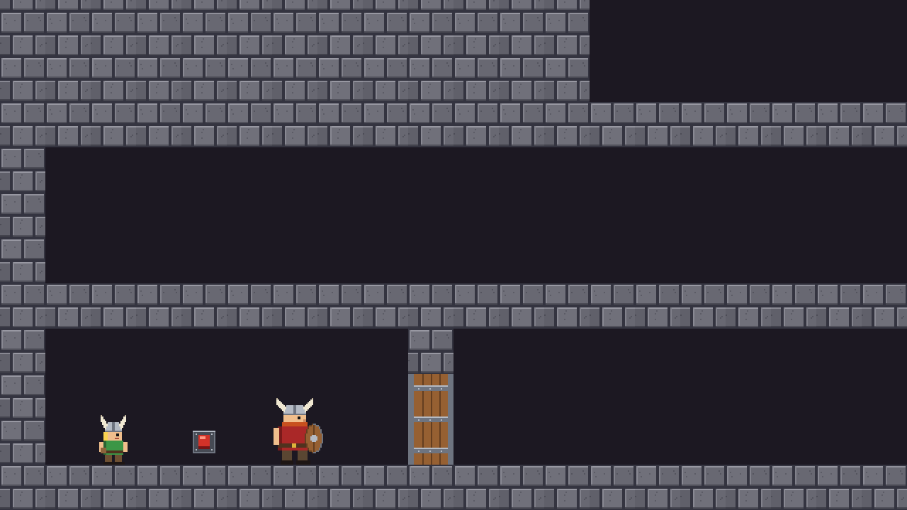

# gm_vikings

A simple "Lost Vikings"-like puzzle platformer made in GameMaker / GML, for teaching children.

Two vikings must reach the exit together:
- **Bjorn** — big and slow, can't jump, his shield always protects him from the front.
- **Kaj** — small, jumps and throws stones.

The camera follows the active viking and glides to the other one when you press `Tab`.
Whole level 1: [docs/level1.png](docs/level1.png), level 2: [docs/level2.png](docs/level2.png).

## How to play

| Key | Action |
|-----|--------|
| ← → | walk |
| ↑ ↓ | climb a ladder |
| `Space` | Kaj: jump |
| `F` | Kaj: throw a stone |
| `E` | push the button you stand at |
| `Tab` | switch viking |
| `R` | restart the level |

- A **button** on the wall toggles something each time it is pushed — by a viking (`E`) or by Kaj's stone.
- A **plate** on the floor toggles something when a viking steps on it, and again when it steps off.
- Things that can be toggled: **doors**, **trapdoors** (over spikes), **lasers** and **ladders** (rolled up / down).
- **Arrow holes** shoot arrows, the **slime** crawls left and right. Only Bjorn's shield stops them.
- Any hit restarts the level. Both vikings in the exit → next level.

## How it works

| Object | What it does |
|--------|--------------|
| `o_Viking` | Parent of `o_Bjorn` and `o_Kaj`. Step: keys, gravity, ladders, walking pixel by pixel with `place_free`, dangers. `Die()`, `IsProtectedFrom()`. |
| `o_Bjorn` | Slower; overrides `IsProtectedFrom()` — the shield. |
| `o_Kaj` | Jumps (Space), throws `o_Stone` (F). |
| `o_Game` | Who is active (Tab), the camera (`MoveCamera`), restart, help text. |
| `o_Button`, `o_Plate` | Call `target.Toggle()`. `target` is set per instance in the room editor (Variables), e.g. `l1_door_1`. |
| `o_Door` (and child `o_Trapdoor`), `o_Laser`, `o_Ladder` | Each has a `Toggle()` function. Starting state is a Variable too. |
| `o_ArrowHole`, `o_Arrow`, `o_Slime` | Enemies. |
| `o_Exit` | Both vikings inside → `room_goto_next()`. |

Walls, closed doors, closed trapdoors and arrow holes are **solid** — that is how `place_free` knows where nobody can go.
Ladders and lasers are made longer with *Scale Y* in the room editor.

## Lessons example

With 1.5 hours per lesson.

1. Project, `s_Wall` / `o_Wall` (solid), room with a 32×32 grid. `o_Viking` with gravity and walking pixel by pixel.
2. `o_Bjorn` and `o_Kaj` as children of `o_Viking`, `o_Game` switches with Tab, the marker, the camera. Kaj jumps. Ladders.
3. Devices: `o_Door` with `Toggle()`, `o_Button` with `target`, then `o_Plate`. Rolling ladders up and down. The exit.
4. Kaj throws stones that push buttons. Arrow holes and arrows, `Die()` and restarting, Bjorn's shield (`IsProtectedFrom`).
5. Trapdoors (child of door) and spikes, lasers, the slime. Sounds. Second level, win room.

## Solutions

Level 1

1. Bjorn walks to the door and faces right. Kaj pushes the button (`E`) — the door opens and arrows fly in, but Bjorn's shield stops them.
2. Bjorn walks to the rolled-up ladder (facing right!). Kaj, behind him, throws a stone over the spikes at the button — the ladder rolls down.
3. Kaj climbs up, then Bjorn climbs up (press ↑ without turning around). Walk right and climb the next ladder.
4. Kaj jumps onto the high ledge and stands on the plate — a ladder rolls down for Bjorn. Both go to the exit.

Level 2

1. Bjorn goes first, Kaj opens the door. Bjorn pushes the slime back with his shield and stops in front of the laser.
2. Kaj pushes the button behind Bjorn — the laser goes off. Bjorn walks to the ladder (facing right), Kaj climbs up, then Bjorn.
3. Kaj jumps over the open trapdoor and pushes the button — the trapdoor closes and Bjorn can cross. Climb the ladder on the left.
4. Kaj throws a stone through the big laser at the button behind it. Both go to the exit.

## Assets

- Graphics: own pixel art, drawn by `tools/make_art.py` (Python + Pillow). Free to use.
- Sounds: made with sfxr (https://sfxr.me, public domain), generated by `tools/make_sfx.js`
  (`npm install jsfxr`, then `node make_sfx.js <output folder>`).
- Fonts: Bernard MT Condensed, the same as in Farm Builder.
